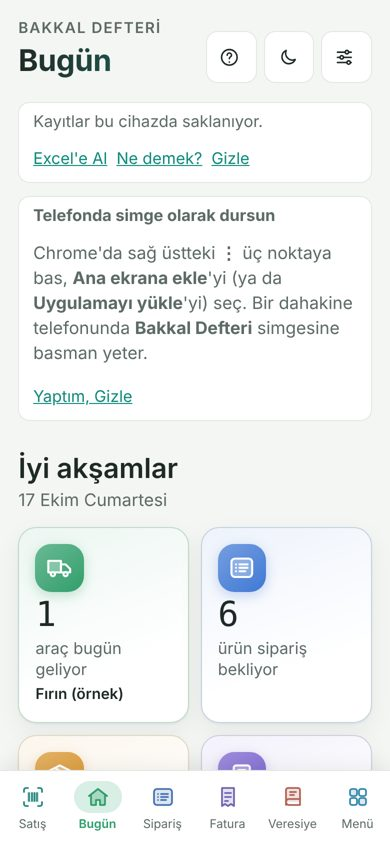
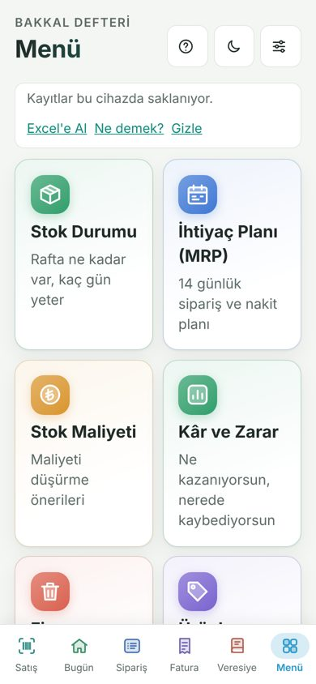
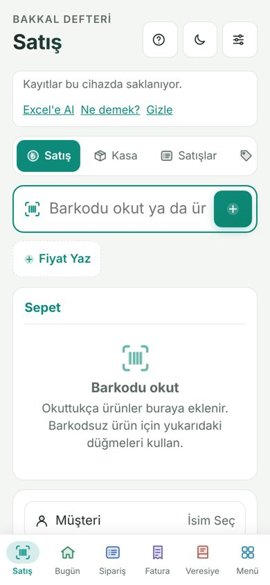

# Bakkal Defteri

Mahalle bakkalı için dükkân defteri: barkodla satış, kasa, stok, sipariş, fatura, veresiye, kâr-zarar ve raporlar. Telefonda, tablette ve bilgisayarda çalışır.

İki uygulama var. İkisi de **aynı hesap ve aynı verilerle** çalışır; birinde yapılan satış ötekinde de görünür.

| | Adres | Kimin için |
|---|---|---|
| **Bakkal Defteri** (tam sürüm) | https://joeamca.github.io/Bakkal/ | Sipariş, fatura, ihtiyaç planı, fire dahil her şey |
| **Bakkal Kolay** | https://joeamca.github.io/Bakkal/kolay/ | Büyük düğmeler, sade ekran: satış, kasa, stok, kâr. Ayrıntılar: [kolay/](kolay/) |

## Neler var?

- **Satış:** Barkod okuyucuyla (USB ya da Bluetooth) okut, sepete eklensin. Nakit, kart ya da veresiye; isimli ya da isimsiz müşteri. Tartılı ürünler için terazi barkodu ve elle kilo girişi.
- **Stok:** Her satışta raftan düşer. Her ürünün yanında − / + ile raftaki sayı düzeltilir; fatura ve "bitti" bilgisiyle de düzelir. Aynı isimle ürün girilince yeni ürün açmak yerine **üstüne ekler**; eskiden çift girilmiş ürünler **Birleştir** ile teke iner.
- **Kasa:** Açılış parası, kasaya giriş ve kasadan çıkış (sebebiyle), gün kapanışı ve kasa farkı.
- **Sipariş ve fatura:** Hangi üründen ne kadar alınacağını, araç günlerine ve özel günlere göre hesaplar.
- **Veresiye:** Kim ne kadar borçlu, ne zamandır bekliyor; borç sınırı.
- **Tedarikçiler:** Veresiyenin tersi: kime ne kadar borcun var. **Mal Geldi** ile stok artar ve tedarikçiye borç yazılır (ya da peşin ödenir); fatura girişi de borç yazar. Kasadan tedarikçiye ödeme yapınca borç düşer. Vade dolunca "ödeme zamanı" hatırlatması gelir. **Sayım** ise sadece düzeltmedir, kimseye borç yazmaz.
- **Kâr-zarar ve raporlar:** Günlük, haftalık, aylık, yıllık satış raporu ve Excel çıktısı (kasa giriş-çıkış sebepleri dahil).
- **Bildirimler:** Stok azalınca, ürün bitince, gün kapanınca, kasadan büyük para çıkınca telefona, tablete ya da bilgisayara simgeli bildirim.
- **Rapor bildirimi:** Dükkân **Gün Kapanışı**'na basınca "Günün raporu hazır" bildirimi gelir (satış, fiş, kâr); pazar günü haftanın, ayın son günü ayın raporu da gelir. Kapanışı unutan dükkâna sunucu saat 23:30'da yine gönderir. Dokununca o dönemin raporu açılır, tek dokunuşla Excel iner.
- **Güvenlik:** Hesaba özel PIN kilidi, e-postayla şifre yenileme. Bir dükkân başka dükkânın kayıtlarını göremez; yönetici de kayıtların içeriğini görmez.

## Nasıl kullanılır?

1. Adresi telefonda **Chrome** ya da **Safari** ile aç.
2. Hesabınla giriş yap (yoksa "Kayıt ol" ile başvur; yönetici onaylar).
3. **Ana ekrana ekle:** Chrome'da üç nokta, iPhone'da Paylaş → "Ana Ekrana Ekle".
4. Bildirim istiyorsan: Ayarlar → **Bildirimleri Aç**. iPhone'da önce ana ekrana eklemek gerekir.

## Bilmen gerekenler

- Kayıtlar internette, dükkânın hesabında durur; telefon değişse de kaybolmaz.
- Uygulama bir kez açıldıktan sonra telefona kaydedilir, **internet yokken de açılır**. İnternetsiz yapılan satışlar telefonda bekler, bağlantı gelince kendiliğinden gönderilir. Kasa hiç durmaz.
- Dükkân sahibi çalışanına ayrı hesap açabilir; kimin ne girdiği görünür.

## Dosyalar

| Dosya | Ne |
|---|---|
| `index.html` | Tam sürüm (tek dosya uygulama) |
| `kolay/` | Bakkal Kolay |
| `sw.js` | Bildirimler ve internetsiz açılış (sayfa önce internetten istenir, yoksa telefondaki kopya açılır) |
| `manifest.webmanifest` | Ana ekrana ekleme bilgileri |
| `icons/` | Uygulama ve bildirim simgeleri |
| `supabase-kurulum.sql` | Veritabanı kurulumu |

## Kurulum (yönetici için)

Veritabanı Supabase'te. `supabase-kurulum.sql` dosyası Supabase panelinde **SQL Editor**'de çalıştırılır; tekrar çalıştırmak güvenlidir, güncelleme gelince yeniden çalıştırılır.
Bildirimler Supabase'teki `bildir` fonksiyonuyla gönderilir.
Sitedeki Supabase anahtarı herkese açık "anon" anahtarıdır; verileri veritabanındaki satır güvenliği kuralları korur.

## Değişiklikler

### 18 Ekim 2026
Uygulamada açılışta bir kez "Yenilikler" kutusu çıkar; **Tamam**'a basınca o cihazda bir daha çıkmaz.

- **Geri tuşu:** Telefonun geri tuşu artık önce açık formu ya da müşteri/ürün ayrıntısını kapatır, sonra bir önceki ekrana döner. Satış'ın Kasa, Satışlar gibi alt ekranları da geri tuşuna dahildir. Formu Vazgeç ile kapatınca geri tuşunda boş adım kalmaz.
- **Küçük telefon (320 px):** İki sütunlu kartlar ekran dışına taşmaz (tam sürümde Menü taşıyordu). Satış'ın alt sekmeleri dar ekranda alt satıra geçer, kesilmez.
- **Tutarlar:** "1.500" yazılan tutar 1.500 TL, "12,5" yazılan 12,5 TL olarak okunur.
- **Saçma değerler:** 999.999.999'dan büyük sayı kabul edilmez. Kasa ve veresiye tutarı 1 milyon TL'yi, sepetteki fiyat 100.000 TL'yi aşarsa "doğruysa tekrar bas" uyarısı çıkar. Barkodsuz ürün, müşteri ve yeni ürün adlarına uzunluk sınırı kondu.
- **Kâr ekranı:** "−0 TL" yazılmaz.
- **Kasa uyarıları:** Kasada olandan fazla çıkış yazılırsa ya da gün ikinci kez kapatılırsa önce uyarır.
- **Rapor bildirimi:** Günün raporu artık "Gün Kapanışı"na basınca gelir (eskiden her akşam sabit saatteydi). Kapanışı yapmayan dükkâna 23:30'da yedek olarak gider. Sunucu tarafı için `supabase-kurulum.sql` yeniden çalıştırılır (güvenli) ve `bildir` fonksiyonu güncellenir (`supabase/functions/bildir/index.ts`).
- **Kolay:** Kasa'da "Diğer" seçilince açıklama kutusu kendiliğinden açılır; rapor ekranı sadeleştirildi; ürün eklerken rafa eksi sayı yazılırsa uyarır.
