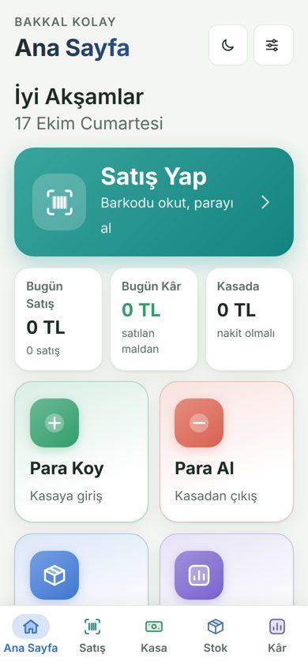
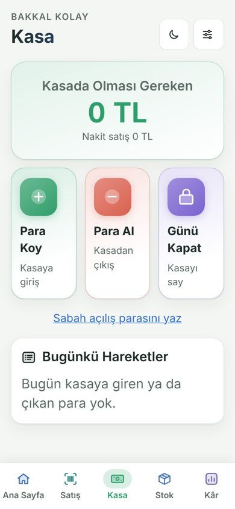
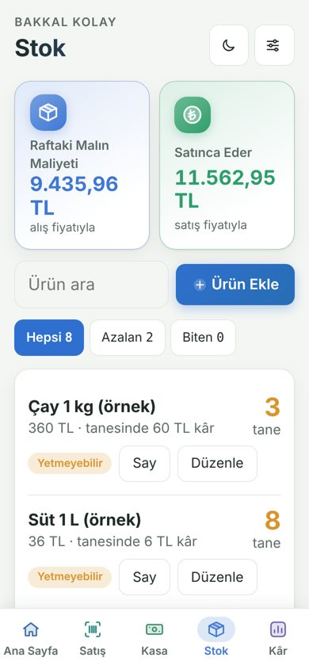
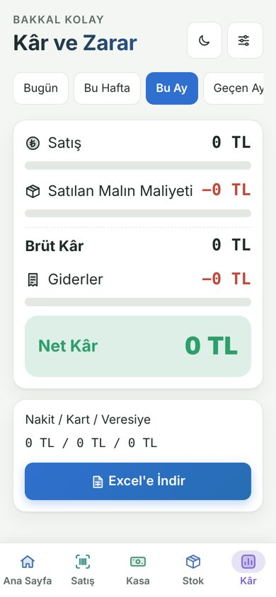

# Bakkal Kolay

**Aç:** https://joeamca.github.io/Bakkal/kolay/

Bakkal Defteri'nin sade hâli: büyük düğmeler, az bölüm, kolay kullanım. Teknolojiyle arası iyi olmayanlar için yapıldı.

**Aynı hesap, aynı veriler.** Bakkal Kolay ayrı bir sistem değil; Bakkal Defteri'yle aynı sunucuyu, aynı hesabı ve aynı kayıtları kullanır. Kolay'da yapılan satış tam sürümde, tam sürümde eklenen ürün Kolay'da görünür. İkisi arasında istediğin an geçebilirsin.

## Bölümler

Alt menüde sadece 5 bölüm var:

| Bölüm | Ne yapılır |
|---|---|
| **Ana Sayfa** | Kocaman "Satış Yap" düğmesi; bugünkü satış, bugünkü kâr ve kasadaki para; Para Koy, Para Al, Stok, Kâr kutuları; azalan ürünler |
| **Satış** | Barkodu okut, sepete eklensin; nakit, kart ya da veresiye |
| **Kasa** | Kasada olması gereken para; Para Koy, Para Al, Günü Kapat; sebep tek dokunuşla seçilir |
| **Stok** | Rafta kaç tane var, fiyatı, tanesinden kalan kâr; sayım, ürün ekleme ve düzenleme |
| **Kâr** | Satış − malın maliyeti − giderler = net kâr; bugün, bu hafta, bu ay, bu yıl; Excel'e indirme |

Sağ üstteki ayar düğmesinde: ürün ekleme, barkodla ürün tanıtma, satış raporları, veresiye, bildirimler, ayarlar ve **tam sürüme geçiş**.

## Kâr nasıl hesaplanır?

- **Brüt kâr** = satış − satılan malın alış fiyatı
- **Net kâr** = brüt kâr − giderler (kira, fatura, personel, çay-yemek…)
- Toptancıya ve ekmekçiye ödenen para gider sayılmaz: o mal parasıdır, mal satılınca maliyet olarak düşülür.
- Bankaya yatırılan ve kendine aldığın para da gider değildir; ayrıca gösterilir.

## Telefona kurmak

- **Android:** Chrome'da aç → üç nokta → "Ana ekrana ekle". Mavi sepet simgesiyle ayrı bir uygulama gibi durur.
- **iPhone / iPad:** Safari'de aç → Paylaş → "Ana Ekrana Ekle". Bildirimler için bu şart.

## Tam sürümle farkı

| | Bakkal Kolay | Bakkal Defteri (tam) |
|---|:---:|:---:|
| Barkodla satış, kasa, stok | ✓ | ✓ |
| Kâr-zarar, Excel rapor | ✓ | ✓ |
| Veresiye, bildirimler | ✓ | ✓ |
| Sipariş önerisi, fatura girişi | | ✓ |
| İhtiyaç planı, stok maliyeti, fire | | ✓ |
| Reçeteli ürünler, araç günleri, özel günler | | ✓ |
